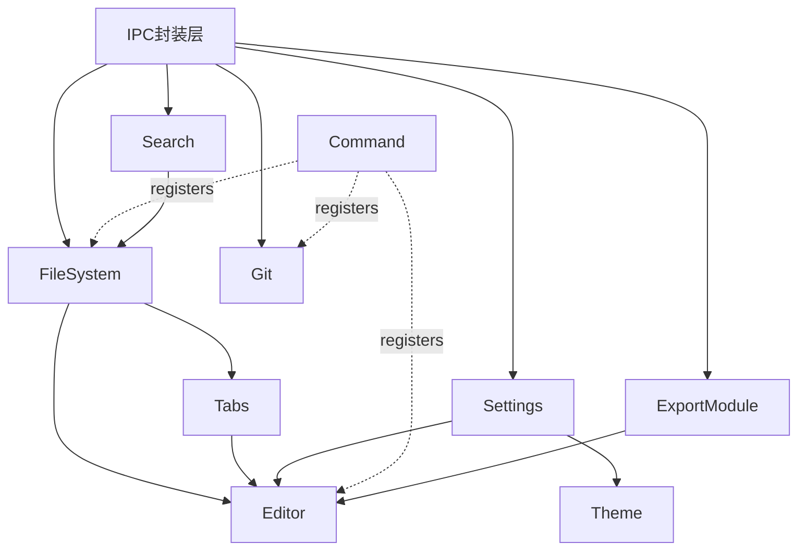

# 项目目录设计与模块划分

## 目录结构

```
MarkMFY/
├── src/                          前端Vue3应用
│   ├── modules/                  按业务能力垂直划分（核心设计）
│   │   ├── editor/                CM6装配、Decoration、语言支持
│   │   ├── filesystem/            文件树、文件读写封装、workspace管理
│   │   ├── tabs/                  多标签状态管理
│   │   ├── git/                   Git面板（状态/diff/历史/分支）
│   │   ├── settings/              设置面板与持久化
│   │   ├── theme/                 主题系统
│   │   ├── command/               命令注册中心/命令面板/快捷键
│   │   ├── search/                 全文搜索（V0.9）
│   │   └── export/                 导出PDF/HTML（V0.8）
│   ├── components/                跨模块通用UI（Sidebar容器、Titlebar等）
│   ├── stores/                    仅放跨模块共享的全局状态
│   ├── ipc/                       前端调用Tauri command的统一封装层
│   ├── types/                     全局TS类型定义
│   └── styles/                    全局样式与主题变量
├── src-tauri/                     Rust后端
│   └── src/
│       ├── commands/               按模块划分的tauri command（fs.rs/git.rs/image.rs）
│       ├── core/                   与tauri无关的纯业务逻辑，方便单测
│       └── error.rs                统一错误类型
├── docs/                          项目规划与架构文档
├── AGENTS.md                      AI协作入口说明
└── README.md
```

### 设计理由

- `src/modules/` 按业务能力垂直切分而非按文件类型水平切分，使每个 Task 尽量只涉及 1-2 个模块目录，天然匹配"每个 Task 独立、可交给不同 AI 完成"的要求。
- `src-tauri` 的 `commands/` 与 `core/` 分离：commands 只做参数校验和调用转发，core 是纯逻辑，方便单测、也方便未来复用。
- `ipc/` 统一封装所有前端到 Rust 的调用，业务模块禁止直接调用底层 invoke，换 IPC 机制或加统一错误处理时只需改一处。
- `docs/` 承载 AI 每次任务开始前必读的项目上下文，是"新增功能不推倒重构"的关键保障之一。

### 扩展方式

新功能以 `src/modules/` 下新增模块目录 + `src-tauri/src/commands/` 下新增命令文件的方式接入，不需要改动已有模块代码。

## 模块划分



- **Editor**：职责是 CM6 装配、Decoration 渲染、语言高亮支持。依赖 FileSystem（获取文件内容）与 Tabs（当前激活文档）。通过 props/emit 与内部 store 通信，不直接依赖 Git/Settings 等无关模块。
- **FileSystem**：文件树读取、文件读写、路径处理，通过 ipc 层调用 Rust 命令。是基础设施模块，被 Editor/Tabs/Git/Search 依赖，自身不依赖业务模块。
- **Tabs**：多标签状态与当前激活文档追踪，依赖 FileSystem，被 Editor 依赖。
- **Git**：状态/diff/commit/历史/分支的 UI 与 ipc 调用封装，依赖 FileSystem 获取 workspace 路径，相对独立，不被其他模块反向依赖。
- **Settings**：设置项定义与持久化，被 Theme/Editor 读取但不反向依赖。
- **Theme**：主题定义与 CSS 变量注入，依赖 Settings，通过 CSS 变量间接影响所有 UI 而非被直接 import。
- **Command**：命令注册中心（发布-订阅式），其他模块向其"注册"命令而不被其感知具体业务逻辑，保证新增模块不需要修改 Command 模块代码。
- **Search**（V0.9）：全文搜索 UI 与调用，依赖 FileSystem。
- **Export**（V0.8）：导出管线，复用 Editor 的解析结果或独立走 markdown-it，依赖 Editor 的内容。

### 通信原则

模块内部用组件+局部 store/composable；跨模块优先通过 Command 的事件机制解耦；前端到 Rust 统一走 ipc 层，禁止绕过封装直接深度耦合。

## 技术选型

- **Tauri v2**：Rust 后端 + 系统原生 WebView（Win 用 WebView2，Mac 用 WKWebView），相比 Electron 包体积小、内存低，本地文件访问原生便捷，天然支持 Win/Mac 双端。
- **Vue3**：Composition API 利于按模块封装逻辑，生态成熟，主流 AI 对其训练数据覆盖充分。
- **TypeScript**：强类型是保证"不同 AI 写出一致代码"的关键工具，是"AI 逐步接工"模式的基础设施。
- **CodeMirror 6（非 Tiptap）**：Tiptap 底层 ProseMirror 没有原生视口虚拟化，大文件在 contenteditable DOM 渲染上有卡顿风险。CodeMirror 6 原生只渲染可见区域 DOM，配合 `@lezer/markdown` 增量解析，是 Obsidian Live Preview 验证过的同类方案，符合"大文件不卡顿、性能优先"的要求。
- **markdown-it**：定位为导出管线专用（V0.8 一次性 HTML 导出），不用于实时编辑渲染。
- **Shiki**：定位为导出场景专用高亮（离线场景不敏感异步加载）。实时编辑器内代码高亮用 CM6 自带的 `@codemirror/language` 系语言包。
- **KaTeX**：数学公式渲染，同步渲染体积小，作为 CM6 的 inline Widget，也可复用于导出 HTML。
